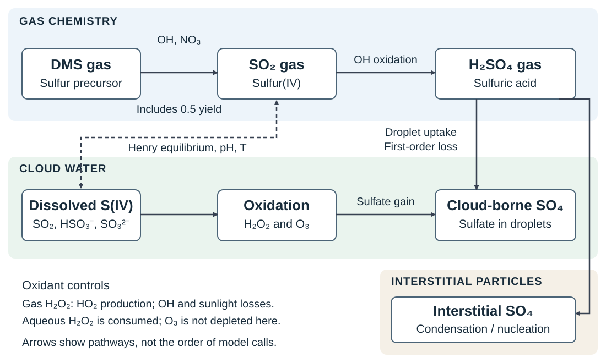

# Sulfur chemistry

Sulfur chemistry connects gaseous precursors to the sulfate carried by aerosol
particles and cloud droplets. In the simplified MAM4xx mechanism, dimethyl
sulfide (DMS) supplies sulfur dioxide (SO₂), gas-phase oxidation converts SO₂
to sulfuric acid (H₂SO₄), and cloud-water oxidation converts dissolved SO₂
directly to sulfate. H₂SO₄ also supplies sulfate through uptake by cloud
droplets, condensation onto existing particles, and new-particle formation.

This chapter explains those pathways for readers familiar with atmospheric
processes but new to MAM4xx. It documents and discusses the equations
implemented in the [source snapshots](#appendix-b-source-map-and-provenance).

## Physical picture

MAM represents aerosol populations using modes: groups of particles with
specified size distributions, each carrying particle number and component
mass. [Liu et al. (2012)](https://doi.org/10.5194/gmd-5-709-2012) describe
MAM3 and MAM7; [Liu et al. (2016)](https://doi.org/10.5194/gmd-9-505-2016)
describe MAM4, which adds a primary-carbon mode to MAM3. Sulfur chemistry
supplies aerosol sulfate mass through two pathways: gas chemistry followed
by condensation, nucleation, or cloud-droplet uptake, and aqueous chemistry
within cloud water.

*Conceptual pathways, independent of model call order. Solid arrows show
tracked sulfur conversion or uptake; the dashed, two-headed arrow shows
gas–liquid equilibrium diagnosed through Henry's law. One DMS branch has a
0.5 tracked SO₂ yield. Activation and cloud evaporation are omitted.
[Open the vector figure at full size](../figures/sulfur-chemistry-pathways.svg).*

Cloud-borne aerosol is carried within cloud droplets. Interstitial aerosol
is suspended outside droplets, including unactivated particles within cloudy
air. Cloud activation and evaporation connect these reservoirs elsewhere in
the model. An *in-cloud* quantity refers to the cloudy fraction of a grid
cell; a *grid-mean* quantity averages over the whole cell, including clear air.

## Species, state, and units

The reduced mechanism tracks a small set of species rather than solving a
complete atmospheric sulfur and oxidant system. Its principal species have
the following roles:

| Species | Role in this mechanism |
|---|---|
| DMS, SO₂, H₂SO₄ | Evolving gas-phase sulfur precursors |
| H₂O₂ | Produced and destroyed in gas chemistry; consumed by aqueous oxidation |
| OH, HO₂, NO₃ | Radical concentrations supplied externally to the gas update |
| O₃ | Aqueous oxidant supplied from the gas state; not depleted by this aqueous routine |
| Modal sulfate | Evolving aerosol component in interstitial and cloud-borne reservoirs |

An evolving field carried between timesteps is *prognostic*. A value
calculated locally from those fields is *diagnostic*. Dissolved SO₂, H₂O₂,
and O₃ concentrations and cloud-water acidity are diagnostics here; the
aqueous routine updates gas and cloud-borne aerosol fields without creating
separately transported aqueous oxidant tracers.

S(IV), or sulfur(IV), denotes dissolved SO₂ together with bisulfite
(HSO₃⁻) and sulfite (SO₃²⁻). S(VI) denotes oxidized sulfur represented as
sulfate. These oxidation-state labels are not additional prognostic species.
Gas rates use molecules and centimeters; aqueous rates use moles and liters.

| Symbol | Meaning | Units and basis |
|---|---|---|
| $x_D,x_S,x_A,x_P,x_O$ | Working gas mixing ratios of DMS, SO₂, H₂SO₄, H₂O₂, O₃ | mol species mol⁻¹ dry air in the host conversion |
| $[X]$ | Gas or radical number concentration used by the rate calculation | molecules cm⁻³ |
| $M$ | Number density calculated from total pressure and temperature | molecules cm⁻³; chemistry normalizer |
| $T,p$ | Temperature and total ambient pressure | K, Pa; aqueous code uses $p_{\rm atm}=p/101300$ in atm |
| $k_r$ | Gas bimolecular rate coefficient | cm³ molecule⁻¹ s⁻¹ |
| $J_P,h_i$ | H₂O₂ photolysis frequency and supplied first-order removal coefficients | s⁻¹ |
| $F_S$ | SO₂ forcing after division by $M$ | mol mol⁻¹ s⁻¹ in the implemented balance |
| $C_X,H_X$ | Dissolved concentration and Henry coefficient | mol L⁻¹ water; mol L⁻¹ water atm⁻¹ |
| $h$ | Hydrogen-ion concentration; $\mathrm{pH}=-\log_{10}(h/(1\ \mathrm{mol\ L^{-1}}))$ | mol L⁻¹ water |
| $f_c,\ell$ | Cloud fraction and in-cloud water volume per air volume | dimensionless |
| $q_i$ | Host mass mixing ratio of component $i$ | kg component kg⁻¹ dry air |

### Mass convention at the chemistry interface

The host converts mass mixing ratios to working molar mixing ratios using

$$
x_i=q_i\frac{W_{\rm air}}{W_i^{\rm conv}},
\tag{1}
$$

where $W_{\rm air}$ is the dry-air molar mass and $W_i^{\rm conv}$ is the
entry in the chemistry conversion table. Both use the same mass/mole units.
Aerosol number mixing ratios have a separate conversion.

The sulfate convention needs particular care:

| Quantity | Molar mass used in the inspected source |
|---|---|
| H₂SO₄ gas conversion | 98.0784 g mol⁻¹ |
| Sulfate-tracer chemistry conversion | 115.10734 g mol⁻¹ |
| Default sulfate aerosol property | 96.06 g mol⁻¹ |

The conversion value is numerically consistent with ammonium bisulfate
(NH₄HSO₄); the default aerosol property corresponds to SO₄. The conversion
table alone does not establish whether every host sulfate field includes
associated ammonium and hydrogen mass. Equation (1) describes the conversion
in this code path.
A physical elemental-sulfur budget additionally requires the represented mass
composition of each field, as discussed in [sulfur bookkeeping](#sulfur-bookkeeping).

### Air basis at the chemistry interface

The host supplies total pressure while converting tracers to dry-air mixing
ratios. The chemistry routines calculate $M$ from total pressure and
temperature, then use it to prepare prescribed concentrations and normalize
production. For an ideal gas, the corresponding physical dry-air relations
are instead

$$
M_d=\frac{p_d}{p}M,\qquad
[X]_{\rm phys}=x_X^d M_d,\qquad
p_X=x_X^d p_d,
\tag{2}
$$

where $p_d=p-p_w$ is dry-air partial pressure, $p_w$ is water-vapor partial
pressure, $M_d$ is dry-air number density, and $x_X^d$ is a dry-air molar
mixing ratio. Thus using $x_X^d M$ or $x_X^d p$ is an approximation in humid
air. The equations below use the implemented total-air convention.

## Gas-phase oxidation

The generated mechanism has seven rate entries. The table shows tracked
species changes, rather than balanced elementary reactions: intermediate
species and some reaction products are absent from the reduced mechanism.

| Entry | Tracked pathway | Rate entering the mixing-ratio equation |
|---|---|---|
| J1 | H₂O₂ photolysis loss | $J_P x_P$ |
| R1 | HO₂ + HO₂ produces H₂O₂ | $k_1[\mathrm{HO_2}]^2/M$ |
| R2 | H₂O₂ + OH removes H₂O₂ | $k_2[\mathrm{OH}]x_P$ |
| R3 | SO₂ + OH produces H₂SO₄ | $k_3[\mathrm{OH}]x_S$ |
| R4 | DMS + OH produces SO₂ with unit yield | $k_4[\mathrm{OH}]x_D$ |
| R5 | DMS + OH produces SO₂ with 0.5 yield | DMS loss $k_5[\mathrm{OH}]x_D$; SO₂ production half that value |
| R6 | DMS + NO₃ produces SO₂ with unit yield | $k_6[\mathrm{NO_3}]x_D$ |

For R1, $k_1[\mathrm{HO_2}]^2$ is a concentration production rate in molecules
cm⁻³ s⁻¹. Division by $M$ gives the rate used in the working mixing-ratio
balance. For R2–R6, multiplication by the supplied radical concentration gives
a first-order coefficient in s⁻¹. Define

$$
\begin{aligned}
a_D &= (k_4+k_5)[\mathrm{OH}]+k_6[\mathrm{NO_3}],\\
b_D &= (k_4+0.5k_5)[\mathrm{OH}]+k_6[\mathrm{NO_3}],\\
a_S &= k_3[\mathrm{OH}],
\end{aligned}
\tag{3}
$$

where $a_D$ is total DMS oxidation loss, $b_D$ is its SO₂-producing
coefficient, and $a_S$ is SO₂ oxidation loss. With inputs fixed during the
chemistry call, the implemented balances are

$$
\begin{aligned}
\frac{dx_D}{dt} &= -(a_D+h_D)x_D,\\
\frac{dx_S}{dt} &= F_S+b_Dx_D-(a_S+h_S)x_S,\\
\frac{dx_A}{dt} &= a_Sx_S-h_Ax_A,\\
\frac{dx_P}{dt} &= \frac{k_1[\mathrm{HO_2}]^2}{M}
 -(J_P+k_2[\mathrm{OH}]+h_P)x_P.
\end{aligned}
\tag{4}
$$

The supplied $h_i$ represent first-order removal; the inspected host prepares
wet-removal rates separately from dry deposition. SO₂ is the sulfur-gas
forcing mapped inside this block. Emissions applied elsewhere must not be
added a second time to equation (4).

All thermal coefficients depend on temperature. R1 also depends on water
vapor and air density. R3 uses pressure *falloff*, a transition between
low- and high-density reaction rates. R5 uses a fixed oxygen air fraction
of 0.21. [Appendix A](#appendix-a-implemented-coefficients) gives the formulas.
The implemented H₂O₂ + OH coefficient matches Table 1, reaction B11, in
[JPL Evaluation 12](https://ntrs.nasa.gov/api/citations/19970037557/downloads/19970037557.pdf#page=26).
This specific match does not establish the lineage of all other coefficients.

## Sunlight and peroxide photolysis

Photolysis competes with the H₂O₂ available for aqueous sulfate production.
Its physical frequency is

$$
J_P(z)=\int \sigma_P(\lambda,T)\,
             \Phi_P(\lambda,T)\,F_{\rm act}(\lambda,z)\,d\lambda,
\tag{5}
$$

where $\sigma_P$ is absorption cross section (cm² molecule⁻¹), $\Phi_P$ is
quantum yield, the number of dissociations per absorbed photon, and
$F_{\rm act}$ is spectral actinic photon flux (photons cm⁻² s⁻¹ nm⁻¹).
The frequency is in s⁻¹. Actinic flux includes light arriving from all
directions; its distinction from plane irradiance is explained by
[Madronich (1987)](https://doi.org/10.1029/JD092iD08p09740).
The OH products of H₂O₂ photolysis are not added to an evolving OH field
by this reduced mechanism.

MAM4xx approximates this integral with tables for wavelengths greater than
200 nm. It interpolates radiative scaling using pressure, solar zenith
angle, ozone column, and effective albedo, then combines it with a solar
photon spectrum and temperature/pressure-dependent cross-section and
quantum-yield data. Cloud and Earth–Sun distance factors modify the result.
The inspected host reader folds wavelength-bin widths into the radiative
table and supplies a fixed solar-spectrum array. The daylight calculation
uses solar zenith angles from 0° to less than 88.85°. Input-table provenance
and technical calling details are recorded in
[Appendix B](#appendix-b-source-map-and-provenance).

## Chemistry in cloud water

### Dissolution and acidity

SO₂ dissolution and acid dissociation are represented by

$$
\begin{aligned}
\mathrm{SO_2(g)}&\rightleftharpoons\mathrm{SO_2\cdot H_2O},\\
\mathrm{SO_2\cdot H_2O}&\rightleftharpoons\mathrm{H^++HSO_3^-},\\
\mathrm{HSO_3^-}&\rightleftharpoons\mathrm{H^++SO_3^{2-}}.
\end{aligned}
\tag{6}
$$

For dissociation constants $K_1,K_2$, the effective Henry coefficient for
total dissolved S(IV) is

$$
H_{S,\rm eff}=H_S\left(1+\frac{K_1}{h}+\frac{K_1K_2}{h^2}\right).
\tag{7}
$$

This coefficient includes the additional dissolved sulfur held as ions.
Consequently, acidity affects both sulfur solubility and its chemical form.
MAM4xx also uses an effective Henry coefficient for H₂O₂ and a Henry
coefficient for O₃.

Let $x_X^{\rm avail}$ be the gas mixing ratio entering the aqueous call,
treated as the inventory available for diagnostic partitioning. The
calculation distributes it between gas and liquid without introducing a
new prognostic dissolved tracer:

$$
x_{X,g}=\frac{x_X^{\rm avail}}{1+H_{X,\rm eff}R_aT\ell},\qquad
C_X=H_{X,\rm eff}\,x_{X,g}\,p_{\rm atm}.
\tag{8}
$$

Here $x_{X,g}$ is the gas mixing ratio after diagnostic partitioning, and
$C_X$ is the dissolved concentration, including dissociated forms when an
effective Henry coefficient is used. $R_a$ is the gas constant in L atm
mol⁻¹ K⁻¹. The pressure product in equation (8) follows the total-pressure
approximation described above; a physical dry-air conversion would use
dry-air partial pressure. The source obtains
$\ell=q_l\rho_{\rm code}/(f_c\rho_w)$, where $q_l$ is grid-mean liquid-water
mass mixing ratio, $\rho_{\rm code}$ is its air-density estimate, and water
density $\rho_w$ is approximated as 1 kg L⁻¹.

The acidity *closure*, or rule used to determine $h$, is a simplified charge
balance. In the source's molar concentration convention it is

$$
h=\frac{K_w}{h}+C_{\mathrm{HCO_3^-}}
 +C_{\mathrm{HSO_3^-}}+2C_{\mathrm{SO_3^{2-}}}
 +\gamma C_{\rm sulfate},
\tag{9}
$$

where $K_w=10^{-14}$ (mol L⁻¹)² is the fixed water-dissociation constant.
The other terms represent bicarbonate, bisulfite, sulfite, and the effective
negative charge attributed to existing cloud-borne sulfate. The source
sets $\gamma=1$, corresponding to its half-neutralized ammonium-bisulfate
assumption. The ion concentrations follow dissolution and dissociation
equilibria at the trial $h$; CO₂ is prescribed at 330 ppm. Existing sulfate
is converted from its in-cloud inventory to concentration per water volume.
Other cloud-water ions are omitted. This is an implemented acidity
assumption, rather than a complete cloud-water composition calculation.

The solver attempts to narrow a pH bracket of 2–7 to a 0.005 pH interval,
with an iteration limit of 20. The caller does not act on its convergence flag;
boundary and failure behavior therefore remain a numerical review item.

### Oxidation of dissolved sulfur

Peroxide and ozone convert S(IV) to sulfate. Laboratory studies describe
the peroxide pathway at low pH
([McArdle and Hoffmann, 1983](https://authors.library.caltech.edu/records/9ngtm-3ze79))
and the dependence of ozone oxidation on the dissolved S(IV) forms
([Hoffmann, 1986](https://authors.library.caltech.edu/records/4cht2-dpk38)).
These references support the reaction mechanisms; the reduced coefficients
below are reconstructed from the inspected implementation.

Its production rates per liquid-water volume are

$$
\begin{aligned}
R_P &= K_P(T,h)\,(H_P x_{P,g}p_{\rm atm})
                    (H_S x_{S,g}p_{\rm atm}),\\
R_O &= K_O(T,h)\,(H_O x_{O,g}p_{\rm atm})
                    (H_{S,\rm eff} x_{S,g}p_{\rm atm}),
\end{aligned}
\tag{10}
$$

in mol L⁻¹ water s⁻¹. $H_P,H_S$ in the peroxide expression are the Henry
coefficients for undissociated species: its acidity dependence is folded
into $K_P$. The ozone expression uses the effective coefficient for total
S(IV). The constants and temperature dependences appear in
[Appendix A](#aqueous-coefficients).

The implemented conversion to an in-cloud working mixing-ratio tendency is

$$
P_{\rm aq}=\frac{R\ell}{c_{\rm air}},\qquad
c_{\rm air}=\frac{1000M}{N_A},
\tag{11}
$$

where $c_{\rm air}$ is total-air molar density in mol L⁻¹ air and $N_A$ is
Avogadro's constant in molecules mol⁻¹. This again uses the total-air
normalizer with dry-air working mixing ratios. Multiplication of an in-cloud
increment by $f_c$ gives the increment applied to grid-mean fields.

The implementation fixes partitioning, acidity, and coefficients before the
reaction updates. It applies peroxide oxidation first, capping consumption
at available SO₂ and H₂O₂, then ozone oxidation, capping consumption at the
remaining SO₂. It does not recalculate equilibrium between them. Peroxide
and SO₂ losses update their gas fields; ozone consumption is not subtracted.
Small positive floors affect stoichiometric balance near zero concentrations.

### Sulfuric-acid uptake by droplets

H₂SO₄ follows a separate uptake calculation rather than Henry partitioning.
Diffusion to spherical droplets gives the first-order uptake coefficient

$$
k_u=4\pi(rN_d)_{\rm eff}D_g\beta,\qquad
\beta=\frac{0.4875(1+\mathrm{Kn})}
 {\mathrm{Kn}(1.184+\mathrm{Kn})+0.4875}.
\tag{12}
$$

Here $r$ is droplet radius (cm), $N_d$ is in-cloud droplet number density
(cm⁻³), $D_g$ is H₂SO₄ gas diffusivity (cm² s⁻¹), and $\beta$ is a
dimensionless correction for molecular transport and surface accommodation.
The Knudsen number $\mathrm{Kn}=3D_g/(v_g r)$ compares a molecular transport
length with droplet radius; $v_g$ is gas molecular speed in cm s⁻¹.
The source assumes an accommodation coefficient of 0.65, the fraction of
incident molecules accepted by the surface. Thus $k_u$ has units s⁻¹.

Liquid water and droplet number determine a common spherical radius. The
code bounds it between 0.5 and 50 µm and adjusts the product $(rN_d)_{\rm eff}$
at those bounds; away from them this product is simply $rN_d$. These bounds
and the accommodation coefficient are model assumptions. Diffusivity depends
on temperature and pressure; molecular speed depends on temperature.

For an interval $\Delta t$, the grid-mean gas loss is

$$
\Delta x_A=-f_c x_A\left[1-\exp\{-\min(100,k_u\Delta t)\}\right].
\tag{13}
$$

The corresponding sulfate gain, together with aqueous-oxidation sulfate,
is assigned among sulfate-bearing modes in proportion to activated particle
number, with a minimum accumulation-mode weight. This assumes droplets
associated with different aerosol modes share a common size. The gain enters
cloud-borne sulfate directly; no separately carried H₂SO₄(aq) field is created.

The aqueous calculation requires at least $10^{-8}$ kg liquid water L⁻¹ air
in cloud. Applying the sulfate gains and gas losses also requires $f_c\geq
10^{-5}$. This routine sets wet removal of unreacted dissolved SO₂ and H₂O₂
to zero; precipitation removal is prepared elsewhere in the host.

## Numerical treatment and process coupling

With inputs fixed, gas production and loss are linear in the evolving mixing
ratios. The gas code targets backward Euler over a chemical step $\delta t$,
evaluating the balance at the updated state:

$$
\mathbf{x}^{n+1}=\mathbf{x}^{n}
 +\delta t\,\mathbf{f}(\mathbf{x}^{n+1}).
\tag{14}
$$

The implementation uses Newton iterations and a sparse linear solve, clips
negative iterates to zero, and contains timestep-cutting logic. Its relative
correction threshold of $10^{-3}$ is a solver stopping criterion, separate
from time discretization error.

The inspected EAMxx host orders the relevant work as follows:

1. Prepare working gas and cloud-borne fields, prescribed radical densities,
   photolysis rates, removal rates, and external forcing.
2. Update gas chemistry if `mam4_do_gas_phase_chemistry` is enabled.
3. Apply aqueous oxidation and droplet uptake if
   `mam4_do_aqueous_phase_chemistry` is enabled.
4. Apply aerosol microphysics, with condensation and nucleation controlled
   by `mam4_do_cond` and `mam4_do_newnuc`.
5. Convert working quantities back to host fields and complete the update.

Both chemistry switches default to true in the host constructor. Within this
ordered sequence, the host fixes H₂SO₄ uptake option 2: aerosol microphysics
uses pre-chemistry and post-cloud-chemistry snapshots to reconstruct net gas
production during condensation. Nucleation uses the mean H₂SO₄ concentration
from that gas–aerosol exchange calculation and is disabled in the cloudy
portion of the cell. A saved chemistry increment must therefore not be added
again as an independent source. The detailed exchange and nucleation
parameterizations are outside this chapter's scope.

## Sulfur bookkeeping

Each DMS, SO₂, H₂SO₄, and sulfate unit contains one sulfur atom. The R5
branch nevertheless produces only half a mole of tracked SO₂ per mole of
DMS consumed. Summing the gas balances gives

$$
\frac{d(x_D+x_S+x_A)}{dt}
=F_S-0.5k_5[\mathrm{OH}]x_D-h_Dx_D-h_Sx_S-h_Ax_A.
\tag{15}
$$

The missing half-yield represents sulfur outside this tracked gas system;
the inspected code does not establish its chemical identity or fate. It
must be included when interpreting a sulfur residual. Aqueous SO₂ oxidation
and H₂SO₄ uptake transfer one mole of tracked sulfur to sulfate per mole
consumed, apart from floors and numerical effects. Gas-phase SO₂ oxidation
first transfers sulfur to H₂SO₄.

For a physical elemental-sulfur budget, component masses must refer to known
chemical compositions. If $q_i^{\rm phys}$ is a mass mixing ratio with a
verified represented composition and $W_i^{\rm phys}$ is that composition's
molar mass, then

$$
B_S=m_d\sum_i q_i^{\rm phys}\nu_{S,i}\frac{W_S}{W_i^{\rm phys}},
\tag{16}
$$

where $m_d$ is dry-air layer mass per unit area, $B_S$ is kg sulfur m⁻²,
$W_S$ is sulfur molar mass, and $\nu_{S,i}$ counts sulfur atoms per unit.
The sum includes sulfur gases and both aerosol reservoirs. For actual SO₄
mass, $W_i^{\rm phys}=96.06$ g mol⁻¹; for NH₄HSO₄ mass it is about 115.1
g mol⁻¹. Neither choice can be assigned to a host field from its name alone.

A ledger derived from the working conversions in equation (1) instead uses
$W_i^{\rm conv}$. Relating that ledger to a physical budget requires
reconciling the sulfate conventions in the host and aerosol-property data.
This chapter does not assume that those two budgets are interchangeable.
Layer mass and tracer mixing ratios must also use the same air basis.
Already grid-mean cloud-borne fields need no second cloud-fraction factor.
Emissions, deposition, transport, the R5 yield, and floors require explicit
accounting in either ledger.

## Evidence and remaining review

This is a source-checked draft, pending scientific-owner review. The checks
cover the implemented algebra, units, species roles, thresholds, and coupling
at the revisions in Appendix B; they introduce no numerical model-validation
results. Remaining questions concern the physical sulfate mass convention,
the consequences of total-air normalization, the fate of untracked R5 sulfur,
the precise lineage and applicable regimes of several coefficients,
photolysis-table generation and contents, and gas-solver/pH failure behavior.
When maintaining the chapter, recheck affected equations, assumptions, figure,
and source map together.

## Appendix A: Implemented coefficients

### Gas coefficients

These expressions reproduce `setrxt` and `usrrxt`. Numerical inputs use K
for $T$ and molecules cm⁻³ for $M$ and $[\mathrm{H_2O}]$; outputs are in
cm³ molecule⁻¹ s⁻¹. The temperature constants in exponentials have units K.

$$
\begin{aligned}
k_1 &= \left(3.5\times10^{-13}e^{430/T}
       +1.7\times10^{-33}M e^{1000/T}\right)\\
    &\quad\times\left(1+1.4\times10^{-21}[\mathrm{H_2O}]e^{2200/T}\right),\\
k_2 &= 2.9\times10^{-12}e^{-160/T},\\
k_4 &= 9.6\times10^{-12}e^{-234/T},\\
k_5 &= \frac{1.7\times10^{-42}e^{7810/T}(0.21M)}
             {1+5.5\times10^{-31}e^{7460/T}(0.21M)},\\
k_6 &= 1.9\times10^{-13}e^{520/T}.
\end{aligned}
\tag{17}
$$

For R3, let $k_0=3.0\times10^{-31}(300/T)^{3.3}$ in cm⁶ molecule⁻² s⁻¹
and $P_r=k_0M/(1.5\times10^{-12})$, with the denominator in cm³ molecule⁻¹
s⁻¹. Then

$$
k_3=\frac{k_0M}{1+P_r}\,0.6^{1/[1+(\log_{10}P_r)^2]}.
\tag{18}
$$

Temperature ratios use K. Positive temperature and density and finite,
nonnegative radical concentrations are required for the intended rates.
The R2 expression matches JPL Evaluation 12; the other entries are not
asserted to reproduce that evaluation or current recommended kinetics.

### Aqueous coefficients

With $t_f=1/T-1/(298\ \mathrm{K})$, Henry coefficients are in mol L⁻¹
atm⁻¹ and dissociation constants in mol L⁻¹. Temperature constants
multiplying $t_f$ have units K:

$$
\begin{aligned}
H_S&=1.23e^{3120t_f}, & K_1&=1.7\times10^{-2}e^{2090t_f},\\
H_P&=7.4\times10^{4}e^{6621t_f}, & K_2&=6.0\times10^{-8}e^{1120t_f},\\
H_O&=1.15\times10^{-2}e^{2560t_f}, & K_{d,P}&=2.2\times10^{-12}e^{-3730t_f}.
\end{aligned}
\tag{19}
$$

Here $H_{P,\rm eff}=H_P(1+K_{d,P}/h)$ and $H_{O,\rm eff}=H_O$. The rate
coefficients used in equation (10) are

$$
\begin{aligned}
K_P(T,h)&=\frac{8.0\times10^4 e^{-3650t_f}}{0.1+h},\\
K_O(T,h)&=4.39\times10^{11}e^{-4131/T}
         +\frac{2.56\times10^3e^{-996/T}}{h}.
\end{aligned}
\tag{20}
$$

These numerical formulas take $h$ in mol L⁻¹ and $T$ in K and return
L mol⁻¹ s⁻¹. The `0.1` denotes 0.1 mol L⁻¹; prefactors carry the units
needed for the result. Changing concentration units requires converting
the constants. The cited laboratory studies support the underlying pathways,
but an exact derivation of these prefactors and their validity ranges remains
to be established.

## Appendix B: Source map and provenance

The kernel description uses clean upstream MAM4xx at
[`e0bccc7f73f8d36d1e1b6c269f4841cacda361bd`](https://github.com/E3SM-Project/mam4xx/commit/e0bccc7f73f8d36d1e1b6c269f4841cacda361bd)
(9 October 2026). Host scheduling and table loading were inspected separately
at E3SM
[`aee833b4f1e4fe43345ca7d084d6c5e8a77e9ec6`](https://github.com/E3SM-Project/E3SM/commit/aee833b4f1e4fe43345ca7d084d6c5e8a77e9ec6),
which records MAM4xx submodule revision
[`b8a1c3cef3060de4817e1f07538e89494b930eef`](https://github.com/E3SM-Project/mam4xx/commit/b8a1c3cef3060de4817e1f07538e89494b930eef).
These separately inspected revisions are not presented as a tested combination.

| Concept / equations | Source and principal routines |
|---|---|
| Species mapping, yields, conversion masses, gas balances (1, 3–4, 15) | [gas_chem_mechanism.hpp](https://github.com/E3SM-Project/mam4xx/blob/e0bccc7f73f8d36d1e1b6c269f4841cacda361bd/src/mam4xx/gas_chem_mechanism.hpp): `adv_mass`, `adjrxt`, `imp_prod_loss`, `indprd` |
| Gas entry point and forcing normalization (4) | [gas_phase_chemistry.hpp](https://github.com/E3SM-Project/mam4xx/blob/e0bccc7f73f8d36d1e1b6c269f4841cacda361bd/src/mam4xx/gas_phase_chemistry.hpp): `gas_phase_chemistry` |
| Gas coefficients and integration (14, 17–18) | [gas_chem.hpp](https://github.com/E3SM-Project/mam4xx/blob/e0bccc7f73f8d36d1e1b6c269f4841cacda361bd/src/mam4xx/gas_chem.hpp): `usrrxt`, `imp_sol`, `newton_raphson_iter`; `setrxt` in the mechanism header |
| Total-air density and prescribed radicals (2) | [mo_setinv.hpp](https://github.com/E3SM-Project/mam4xx/blob/e0bccc7f73f8d36d1e1b6c269f4841cacda361bd/src/mam4xx/mo_setinv.hpp): `setinv_single_level` |
| Cloud dissolution, acidity, oxidation, uptake (6–13, 19–20) | [mo_setsox.hpp](https://github.com/E3SM-Project/mam4xx/blob/e0bccc7f73f8d36d1e1b6c269f4841cacda361bd/src/mam4xx/mo_setsox.hpp): `setsox_single_level`, `henry_factor_*`, `calc_ynetpos`, `calc_ph_values`, `calc_sox_aqueous`, `cldaero_uptakerate`, `sox_cldaero_update`, `compute_aer_factor` |
| Photolysis construction (5) | [mo_photo.hpp](https://github.com/E3SM-Project/mam4xx/blob/e0bccc7f73f8d36d1e1b6c269f4841cacda361bd/src/mam4xx/mo_photo.hpp): `table_photo`, `cloud_mod`, `interpolate_rsf`, `jlong` |
| Gas–aerosol coupling and cloudy/clear switches | [mam4_amicphys.hpp](https://github.com/E3SM-Project/mam4xx/blob/e0bccc7f73f8d36d1e1b6c269f4841cacda361bd/src/mam4xx/mam4_amicphys.hpp): `mam_amicphys_1gridcell`, `mam_amicphys_1subarea`, `mam_newnuc_1subarea` |
| Default sulfate property mass | [aero_species.cpp](https://github.com/E3SM-Project/mam4xx/blob/e0bccc7f73f8d36d1e1b6c269f4841cacda361bd/src/mam4xx/aero_species.cpp): `default_aero_species`; [mam4_constants.hpp](https://github.com/E3SM-Project/mam4xx/blob/e0bccc7f73f8d36d1e1b6c269f4841cacda361bd/src/mam4xx/mam4_constants.hpp): `molec_weight_so4` |
| Wet-removal coefficients | [mo_sethet.hpp](https://github.com/E3SM-Project/mam4xx/blob/e0bccc7f73f8d36d1e1b6c269f4841cacda361bd/src/mam4xx/mo_sethet.hpp): `sethet`, `calc_het_rates` |
| Host sequence and working-state conversions (1) | [EAMxx microphysics functions](https://github.com/E3SM-Project/E3SM/blob/aee833b4f1e4fe43345ca7d084d6c5e8a77e9ec6/components/eamxx/src/physics/mam/eamxx_mam_microphysics_process_functions.cpp): `MAMMicrophysics::run_microphysics_kernels` |
| Host pressure and dry-air fields (2) | [EAMxx generic interface](https://github.com/E3SM-Project/E3SM/blob/aee833b4f1e4fe43345ca7d084d6c5e8a77e9ec6/components/eamxx/src/physics/mam/eamxx_mam_generic_process_interface.cpp): `populate_dry_atm`; [mam_coupling.hpp](https://github.com/E3SM-Project/E3SM/blob/aee833b4f1e4fe43345ca7d084d6c5e8a77e9ec6/components/eamxx/src/physics/mam/mam_coupling.hpp): `compute_dry_mixing_ratios`, `atmosphere_for_column` |
| Host switches and table inputs | [EAMxx microphysics interface](https://github.com/E3SM-Project/E3SM/blob/aee833b4f1e4fe43345ca7d084d6c5e8a77e9ec6/components/eamxx/src/physics/mam/eamxx_mam_microphysics_process_interface.cpp): constructor, `run_impl` |
| Solar spectrum and wavelength widths | [EAMxx photolysis reader](https://github.com/E3SM-Project/E3SM/blob/aee833b4f1e4fe43345ca7d084d6c5e8a77e9ec6/components/eamxx/src/physics/mam/readfiles/photo_table_utils.cpp): `read_photo_table`, `populate_etfphot_from_e3sm_case` |

The legacy name `jlong` denotes the wavelength component longer than 200 nm,
not thermal infrared radiation. The caller must initialize the photolysis
output because `table_photo` accumulates into it. The host's online solar
rebinning call is inactive. Cross-section wavelength support and generation
history must be checked against the actual NetCDF input tables.

## References

- DeMore, W. B., et al. (1997). *Chemical Kinetics and Photochemical Data for
  Use in Stratospheric Modeling*, Evaluation 12, JPL Publication 97-4.
  [NASA report](https://ntrs.nasa.gov/api/citations/19970037557/downloads/19970037557.pdf).
  Table 1, B11 supports the R2 coefficient specifically.
- Hoffmann, M. R. (1986). *On the kinetics and mechanism of oxidation of
  aquated sulfur dioxide by ozone*. Atmospheric Environment, 20, 1145–1154.
  [doi:10.1016/0004-6981(86)90147-2](https://doi.org/10.1016/0004-6981(86)90147-2).
- Liu, X., et al. (2012). *Toward a minimal representation of aerosols in
  climate models: description and evaluation in the Community Atmosphere
  Model CAM5*. Geoscientific Model Development, 5, 709–739.
  [doi:10.5194/gmd-5-709-2012](https://doi.org/10.5194/gmd-5-709-2012).
- Liu, X., et al. (2016). *Description and evaluation of a new four-mode
  version of the Modal Aerosol Module (MAM4) within version 5.3 of the
  Community Atmosphere Model*. Geoscientific Model Development, 9, 505–522.
  [doi:10.5194/gmd-9-505-2016](https://doi.org/10.5194/gmd-9-505-2016).
- Madronich, S. (1987). *Photodissociation in the atmosphere: 1. Actinic flux
  and the effects of ground reflections and clouds*. Journal of Geophysical
  Research: Atmospheres, 92, 9740–9752.
  [doi:10.1029/JD092iD08p09740](https://doi.org/10.1029/JD092iD08p09740).
- McArdle, J. V., and Hoffmann, M. R. (1983). *Kinetics and mechanism of the
  oxidation of aquated sulfur dioxide by hydrogen peroxide at low pH*.
  Journal of Physical Chemistry, 87, 5425–5429.
  [doi:10.1021/j150644a024](https://doi.org/10.1021/j150644a024).

## Revision History

| Date | Author / agent | Summary |
|---|---|---|
| 2026-10-12 | Codex | Create the first sulfur chemistry Theory Guide chapter from the existing design; recheck source equations and coupling, redraw the conceptual pathways, and retain explicit evidence limits and pending scientific review. |
| 2026-10-13 | Codex | Address chapter review: distinguish sulfate mass and air-basis conventions; add acidity and droplet-uptake closures and verified literature; define terminology, consolidate qualifications, and move coefficients and source details into appendices. |
